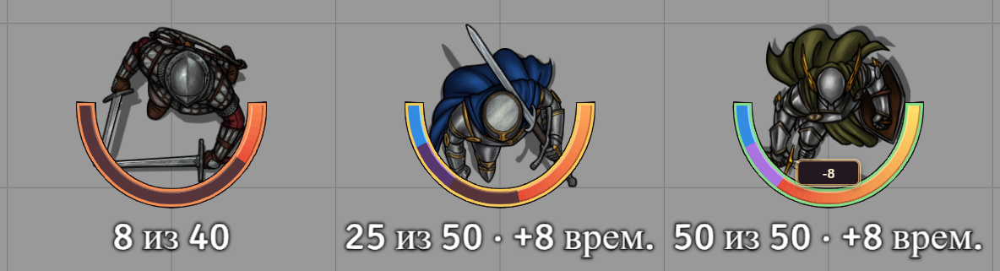

# MJl - Token Display

Модуль для Foundry VTT 14.361 и системы D&D 5e 5.3.3.



В меню настройки Foundry откройте **Модули → Установить модуль** и вставьте адрес манифеста.

```text
https://raw.githubusercontent.com/MJl2517/MJl-Token-Dislplay/main/module.json
```

Включите **MJl — Здоровье и оружие на токене** через «Управление модулями» в нужном мире.

Дуга заменяет стандартную полосу «Очки здоровья» и следует настройке «Отображение полос» у токена. Если обе полосы пустые, модуль берёт здоровье из листа персонажа. Обводка плавно меняется от красной при 0 ОЗ до зелёной при полном здоровье. Синий фрагмент показывает временные ОЗ, фиолетовый — прибавку к максимуму. Незанятая часть фиолетового фрагмента темнее.

Нажмите на дугу, чтобы открыть поле ввода на токене. Положительное число восстанавливает ОЗ, отрицательное наносит урон. Колесо над полем меняет значение на 1, Enter применяет его, Esc отменяет. Поле доступно ведущему и пользователям с правом редактировать актёра.

В нижних углах видны иконки экипированных предметов. Основное оружие — справа, второе оружие или щит — слева. Двуручное оружие занимает обе руки. Полуторное занимает обе, если вторая свободна. Если экипировано несколько подходящих предметов, модуль сначала учитывает двуручное оружие, затем порядок оружия в инвентаре. Щит имеет приоритет во второй руке.

Чтобы занять руку факелом, фокусировкой или другим предметом, экипируйте его и выберите «Предмет занимает руку» в меню заголовка листа предмета. Повторный выбор снимает отметку. Иконки видны пользователям, которые видят сам токен, с учётом секретной диспозиции.

Если включены Argon Combat HUD CORE и DND5E, токен показывает основной и дополнительный слоты активного комплекта Argon. Пустой слот остаётся свободным, кроме двуручного и полуторного хвата. Синхронизация работает даже при закрытом HUD и без настройки Argon, меняющей экипировку при переключении. Для персонажей, у которых ещё не выбран или не задан комплект, используются экипированные предметы. Связку можно выключить в настройках модуля.

Проверки из папки модуля — `node --test token-display.test.mjs`.
